# 暖立方

<div align="center">
  
  <p><strong>Nikki³ · 无限暖暖工具集</strong></p>
  <p>暖立方（NikkiCube）在浏览器中整理相册、搭配码、家园方案和相机参数；「暖暖档案」提供共鸣记录、个人衣橱与妆容图鉴。支持数据备份、可选云同步及电脑端专项清理。</p>
  <p style="color: orange;">如果遇到问题，请及时在网站内问题反馈处填写问卷，或在 GitHub / Gitee 的 Issues 或作者社交平台反馈。</p>
  <p>
    <a href="https://github.com/sumopenny/Infinity-Nikki-Toolkit/releases">GitHub Releases</a> ·
    <a href="https://gitee.com/sumopenny/Infinity-Nikki-Toolkit/releases">Gitee Releases</a> ·
    <a href="https://github.com/sumopenny/Infinity-Nikki-Toolkit">GitHub</a> ·
    <a href="https://gitee.com/sumopenny/Infinity-Nikki-Toolkit">Gitee</a>
  </p>
  <p><a href="README_EN.md"><strong>English</strong></a></p>
</div>

<div align="center">
  <h3><a href="#手机端">📱 手机使用</a> &nbsp; · &nbsp; <a href="#电脑端">🖥️ 电脑使用</a> &nbsp; · &nbsp; <a href="#备份与迁移">📦 备份迁移</a> &nbsp; · &nbsp; <a href="#本地安装">⚙️ 本地安装</a></h3>
</div>

## 快速开始

### 官网入口

**官网（介绍与界面展示）：[https://nikki3.pages.dev/](https://nikki3.pages.dev/)**

**实际使用入口（工具集）：[https://nikkicube.pages.dev/](https://nikkicube.pages.dev/)**

直接打开即可使用，无需下载。本地功能无需登录，搭配、家园、相机参数和暖暖档案无需先选择相册；只有浏览游戏照片时才需要选择相册，使用共鸣与衣橱云同步时才需要登录。

需要本地运行时，再看[本地安装](#本地安装)。

| 功能 | 手机／平板 | 电脑 |
| --- | --- | --- |
| 搭配码、家园方案、相机参数 | 支持 | 支持 |
| 共鸣记录、个人衣橱与妆容图鉴 | 支持 | 支持 |
| 手动备份迁移、共鸣与衣橱云同步 | 支持 | 支持 |
| 输入码或上传原图解析 | 支持 | 支持 |
| 游戏相册目录管理与最近删除 | 不支持 | 需目录授权 |
| 自动读取游戏搭配码 | 不支持 | 需 X6Game 授权 |
| 专项清理游戏文件 | 不支持 | 需 X6Game 授权 |

[Pages 部署与数据库配置](docs/pages-deployment.md)

## 官网展示

<div align="center">
  
  
  <p><sub>左 · 官网浅色首页 ｜ 右 · 官网深色首页：站点介绍、功能一览与工具集入口</sub></p>
</div>

完整介绍与界面展示请访问 [官网](https://nikki3.pages.dev/)，重点界面见下方各模块。详细教程请进入 [暖立方](https://nikkicube.pages.dev/) 查看「使用帮助」及对应模块的导入指引。

## 手机端

手机、平板及折叠屏会随可用宽度调整布局。以下截图展示主要入口与操作。

### 首次使用与导航

- 底部切换“搭配码、家园方案、相机参数、暖暖档案”；档案内可切换共鸣记录、个人衣橱、妆容图鉴和满进动画。
- 顶部放大镜搜索当前模块，“视图”调整显示、主题与语言，“工具”提供解析、头像模拟器和抽卡吉时。“更多”提供全部数据备份，选择“使用帮助”可速查手势。
- 页面“+”添加数据，“⋯”管理本模块；标签或星级入口用于筛选。大图支持左右滑动、双指缩放和拖动查看。
- 相册目录管理、自动读取游戏搭配与专项清理请在电脑端使用。手机端可从“更多 → 应用维护 → 安装应用”查看添加到主屏幕的指引，安装方式取决于浏览器。

### 搭配码

保存搭配图片与分享码，随时复制、编辑或解析。

<div align="center">
  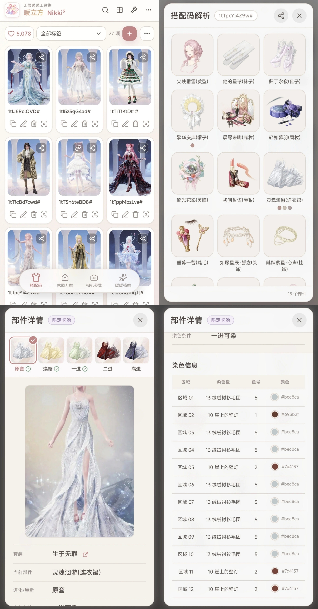
  <p><sub>搭配码列表与部件详情</sub></p>
</div>

- 点页面“+”添加图片或搭配码，**图片与搭配码任选其一即可保存**，再按需补充备注和标签。
- 电脑端在搭配码页点“搭配总结”，手机端从“页面操作”（…）打开。概览展示解析覆盖、收藏趋势和标签分布。点击标签会打开对应搭配。
- 卡片底部提供复制、编辑、删除和解析；未填写码时复制与解析不可用，单击图片可看大图，点击右下角圆圈可多选。
- 点标签入口筛选或管理标签，点页面“⋯”导入／导出本模块 ZIP。

### 家园方案与相机参数

<div align="center">
  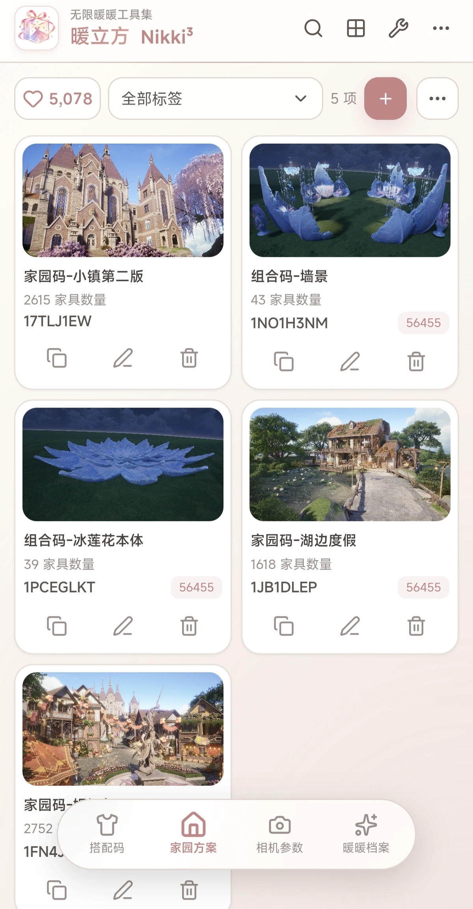
  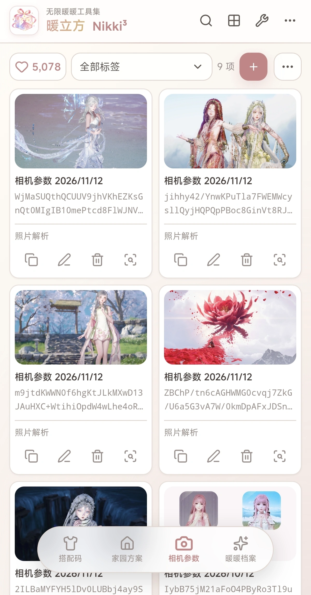
  <p><sub>左 · 家园方案 ｜ 右 · 相机参数</sub></p>
</div>

**家园方案**

- 点“+”输入家园码或组合码，解析后填写名称、封面、备注和标签并保存。
- 卡片底部提供复制、编辑和删除；可按码类型或标签筛选，单击图片查看大图。

**相机参数**

- 点“+”输入参数码，解析成功后填写名称并保存，可添加封面和标签；也可从照片解析结果收藏。
- 卡片底部提供复制、编辑、删除和详情；复制出的参数码可在游戏相机中导入。

两类收藏均从页面“⋯”菜单导入／导出 ZIP。删除标签只移除分类，不删除对应记录。

### 暖暖档案

底部进入“暖暖档案”，在页面上方切换“共鸣记录”“个人衣橱”和“妆容图鉴”。

<div align="center">
  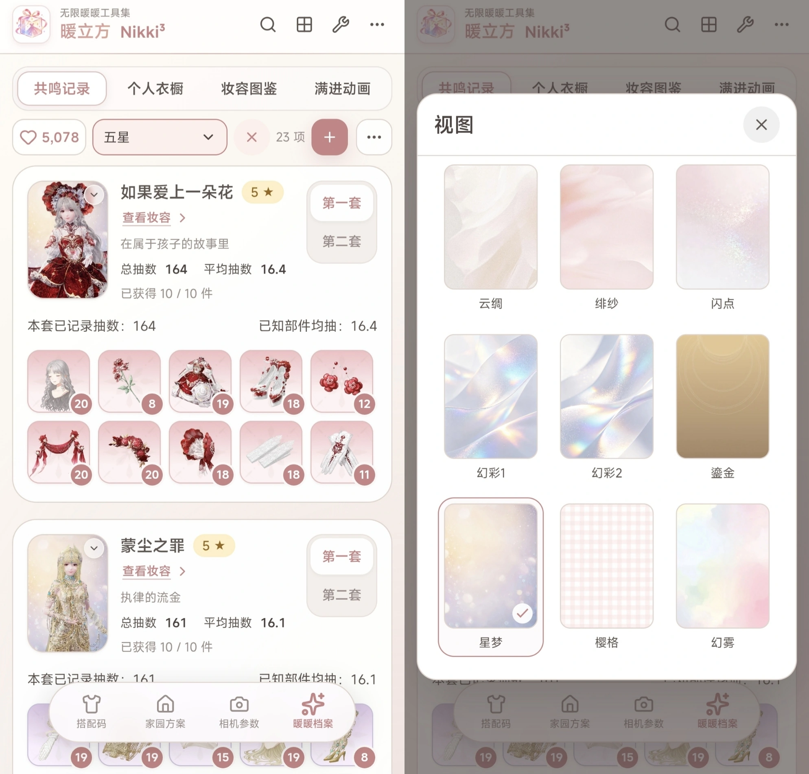
  <p><sub>共鸣记录：统计、收集进度与第一套／第二套切换</sub></p>
</div>

- **共鸣记录**：点“+”导入数据，核对预览后确认；通过星级入口筛选和定位套装，卡片上切换第一套／第二套。
- 多形态套装的主图右上角提供展开按钮，可选择原套、焕新或进化形态并直接查看详情；绿色勾选表示衣橱数据中已拥有，不改变共鸣抽数统计。
- 页面“⋯”提供导出、清空本地记录及账号操作；登录后可手动上传或下载云端记录。

<div align="center">
  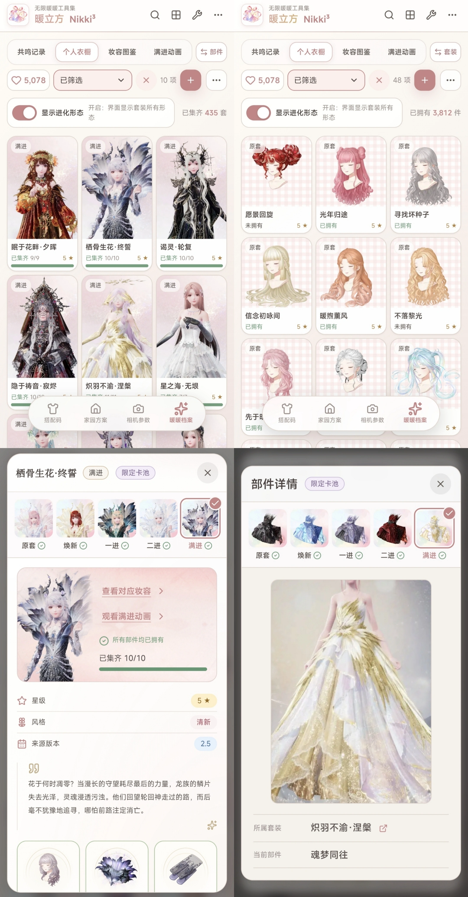
  <p><sub>个人衣橱：套装、部件与收集详情</sub></p>
</div>

- **个人衣橱**：切换套装／部件视图，搜索名称或 ID，按拥有状态、星级、版本等条件筛选并查看详情。
- “显示进化形态”开启时分别展示各形态，关闭时合并同系列卡片；点击卡片右上角的展开图标选择形态，直接打开对应详情，也可在详情标题下方切换形态。
- 点“+”导入衣橱数据，页面“⋯”提供导出、清空和云端同步操作。导入覆盖与云同步规则见[备份与迁移](#备份与迁移)。

**妆容图鉴（手机端）**

<div align="center">
  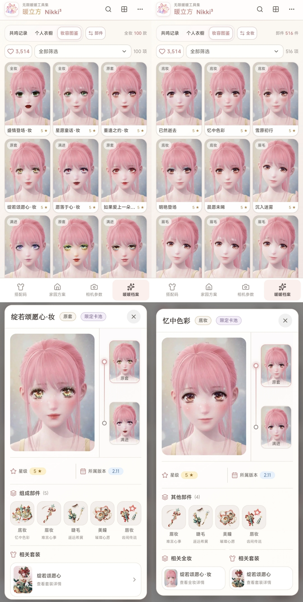
  <p><sub>手机端 · 全妆／部件浏览、进化形态切换与详情</sub></p>
</div>

- 可按全妆、底妆、眉妆、睫毛、美瞳、唇妆分类浏览，按版本、获取来源、星级筛选，支持搜索名称或 ID。
- 点击卡片查看妆容大图、组成部件、进化形态及关联全妆／套装，并可继续进入相关详情；无需先导入个人衣橱。

## 电脑端

### 首次使用与导航

使用电脑上的 Chrome、Edge 或兼容的 Chromium 浏览器。左侧切换模块并筛选，顶部搜索当前模块；“视图”调整显示、主题、语言和可选背景，“工具”打开解析和辅助功能，“更多”提供全部数据备份与帮助。

#### 电脑端 · 安装网页应用

可从网站的“添加到桌面”入口查看电脑浏览器的安装步骤。支持的浏览器可将网站安装为独立窗口使用；实际安装入口和提示由浏览器决定。

### 相册浏览、照片解析与最近删除

按日期或动作浏览游戏照片，查看大图、收藏照片并解析拍摄参数与照片中的穿搭。

<div align="center">
  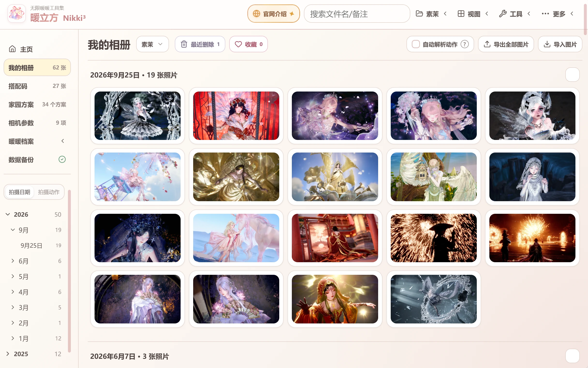
</div>

点击「授权X6Game」，选择游戏安装目录里的 `X6Game` 文件夹：

```text
...\InfinityNikki Launcher\InfinityNikki\X6Game
```

网站会查找 `Saved\GamePlayPhotos` 下的高画质相册，并打开按 UID 排序的第一个账号。有多个账号时，在「全部照片」标题旁切换。搭配码与专项清理复用同一授权。要更换游戏相册目录，点击「重新选择X6Game」。如果照片存放在其他文件夹，可以用「打开独立相册」打开。

右上角相册菜单会显示当前角色的昵称、头像、等级、角色创建时间和更新时间，资料查不到时仍可用 UID 识别相册。

#### 兼容打开（只读）

普通授权无法打开相册时，可选择「兼容打开（只读）」，直接选择存放照片的文件夹。支持浏览、筛选、大图、参数解析和查看已有收藏与备注，不上传照片，也不修改原目录。

此模式不能修改收藏、备注，不能删除、恢复或导入原目录；导出以 ZIP 下载。刷新网页或获取新照片时需重新选择文件夹。需要编辑时，请切回普通目录授权模式。

#### 照片操作

点击照片查看大图，使用图片右下角圆圈多选；支持收藏、备注、批量导出与删除。大图可缩放、拖动和切换照片，快捷键与手势见网站内「使用帮助」。

照片收藏与备注保存在相册内的 `album-metadata.json`，换浏览器打开同一相册即可读取，备份相册时请一并保留。

> 普通删除将原图移入「最近删除」；**永久删除和专项清理会删除电脑中的真实文件，无法恢复。**

#### 最近删除与刷新

- 最近删除按删除时间排序，顶部显示照片总数和总大小；支持单张或批量恢复、永久删除、全选、大图预览和清空全部。
- 恢复时若原相册已有同名文件，会自动使用 `_restored_1`、`_restored_2` 等后缀，不会覆盖现有照片。
- 最近删除不会自动过期，会一直保留到手动恢复或永久删除。

#### 照片分享图

从照片卡片或参数窗口生成竖／横版分享图，可选拍摄参数、穿搭部件及相机参数码；预览支持拖动和最高 400% 缩放。

### 搭配码与自动更新

<div align="center">
  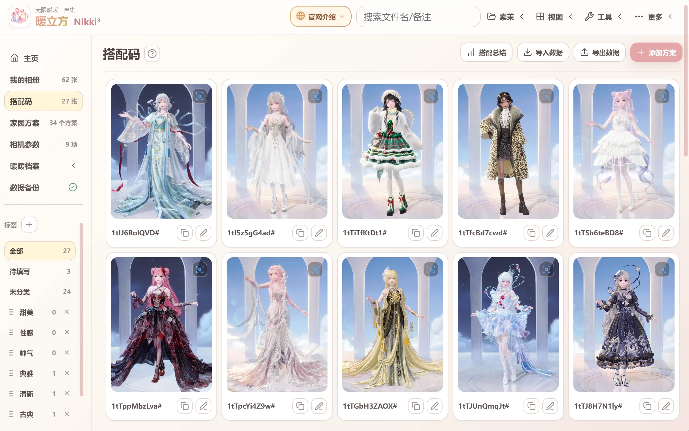
</div>

- 点击“添加方案”选择、拖拽或粘贴图片，或填写搭配码；**图片与搭配码任选其一即可保存**，备注和标签按需添加。单击图片查看大图，点击右下角圆圈或在手机端长按图片可多选并使用底部操作栏。
- 卡片提供复制、编辑、删除与解析；左侧管理分类和标签顺序。最多创建 40 个用户标签，每个最多 5 个字符，方案最多选择一个标签。
- 可在编辑窗口选填来源链接，粘贴分享文案会提取其中的单个网页链接；多个链接需保留一个。电脑和手机卡片上的链条图标可直接打开原帖，来源链接随备份保存。
- 备注在编辑窗口查看和修改，可通过顶部搜索查找；搭配收藏独立保存在浏览器中，不读取或迁移旧相册目录。

#### 自动更新搭配码

详细操作步骤与图示请前往 [官网](https://nikki3.pages.dev/) 查看。

搭配码可复用游戏相册的 `X6Game` 授权。单独给工具授权时，在「搭配码」的页面操作里选择「授权 X6Game」。在游戏内点击分享、框选搭配截图并生成搭配码，再返回网页。只有新搭配码和已更新的图片才能导入；重复码、图片未更新或缺图时会跳过并提示。

#### 搭配码解析

使用卡片解析按钮，或从“工具 → 参数/搭配码解析”直接输入码，无需先创建方案。未填写码的方案不能复制或解析。

点击解析结果中的部件可查看详情；存在多个形态时，电脑端在左侧、手机端在标题下方展示形态切换入口。切回搭配码中的穿戴部件会保留原染色，其他形态展示其自身详情；已拥有形态的名称后显示绿色勾选。

#### 搭配总结与分享图

- 标签按全部收藏统计，含纯图片搭配。服装和妆容排行显示单品在已解析搭配中的出现套数和比例，可按部位筛选并打开详情。打开总结先读取本机缓存，只有点击解析或重试，才会将尚未成功解析的搭配码发送给解析服务。
- 有图片的搭配可从卡片或解析窗口生成 9:16 分享图，预览支持拖动和最高 400% 缩放。

### 家园方案

- 点击“添加方案”，输入家园码或组合码，解析后填写名称、封面、备注与标签并保存。
- 左侧按码类型或标签筛选；卡片提供复制、编辑和删除，单击图片可看大图。
- 页面操作区提供本模块 ZIP 导入导出；删除标签不删除对应方案。

### 相机参数

- 在“相机参数”模块添加参数码，解析成功后填写名称并保存，可添加封面与标签。
- 也可从照片解析结果直接保存；卡片提供复制、编辑、详情和删除，复制出的参数码可在游戏相机中导入。
- 照片含穿搭时，电脑端可通过“保存参数”左侧的视图按钮切换上下／左右布局；首次默认左右布局，之后记住上次选择；左右布局底部保留整行参数码，手机端使用上下布局且不覆盖电脑布局偏好。
- 解析游戏原图后，参数窗口下方会显示照片保存的穿搭部件和染色色块；点击部件可查看染色详情。照片未保存搭配信息时不显示该区域，独立参数码不包含穿搭。较新照片还可能显示天气、风力／风向、缩放及动作播放进度等字段（以原图记录为准）。
- 页面操作区提供本模块 ZIP 导入导出。“工具”中的参数解析还支持直接输入参数码或选择游戏原图。

### 暖暖档案

从左侧“暖暖档案”进入共鸣记录、个人衣橱或妆容图鉴。

<div align="center">
  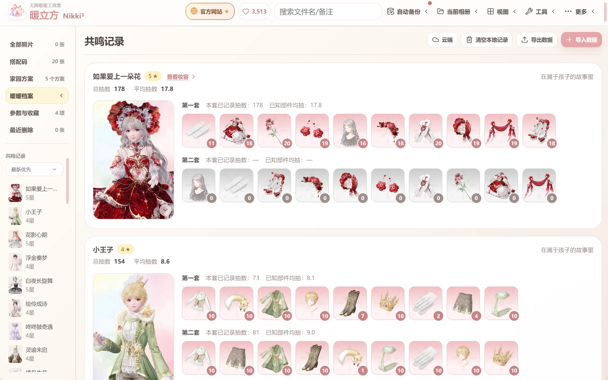
</div>

- **共鸣记录**：添加手账凭据或 JSON 数据，核对预览后确认；左侧可排序、筛选星级并定位套装。
- 点击套装主图右下角的展开按钮查看各形态，选择后打开对应详情；只有确认已拥有的形态显示绿色勾选，记录与统计保持不变。
- 电脑同时展示第一套与第二套，每套展示已记录抽数、已知部件均抽和收集进度；标题显示两套合计统计。手动补录计入收集进度，无已知抽数时显示“—”。
- 页面操作区提供 JSON 导出、清空本地记录及账号云同步。

<div align="center">
  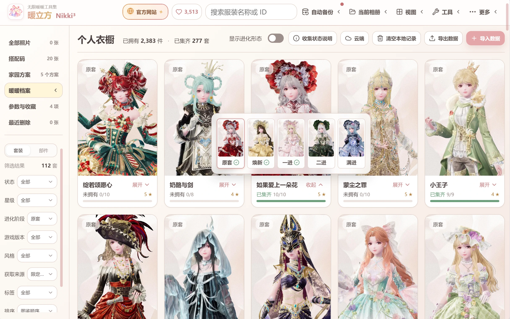
</div>

- **个人衣橱**：查看原套、焕新及进化版本；切换套装／单品，搜索名称或 ID，按星级、版本、部位和拥有状态等筛选并查看详情。
- 通过“显示进化形态”开关选择展示全部形态或合并同系列卡片，显示偏好会自动保存。合并后可展开卡片选择形态，也可在套装和部件详情中切换；电脑端套装详情还会显示来源标签。
- 支持国服及全部国际区服奇想手账或衣橱 JSON 导入，单独导出 JSON；可在同一次手账预览中选择共鸣和衣橱。单独清空衣橱不影响共鸣。衣橱与共鸣共用账号和同步窗口，可一次上传、下载或删除所选模块的云端存档。妆容图鉴无需导入个人数据即可浏览，图鉴素材不属于衣橱云同步存档。
- 导入前请查看[备份与迁移](#备份与迁移)中的覆盖规则。

### 满进动画

在“暖暖档案”选择“满进动画”，按版本从新到旧浏览套装动画。顶部展示当前套装，点击播放或下方卡片加载 B 站播放器；套装详情中的“观看满进动画”可直达对应视频。每项均可通过“在 B 站观看”打开原分 P。

### 妆容图鉴与背景切换

<div align="center">
  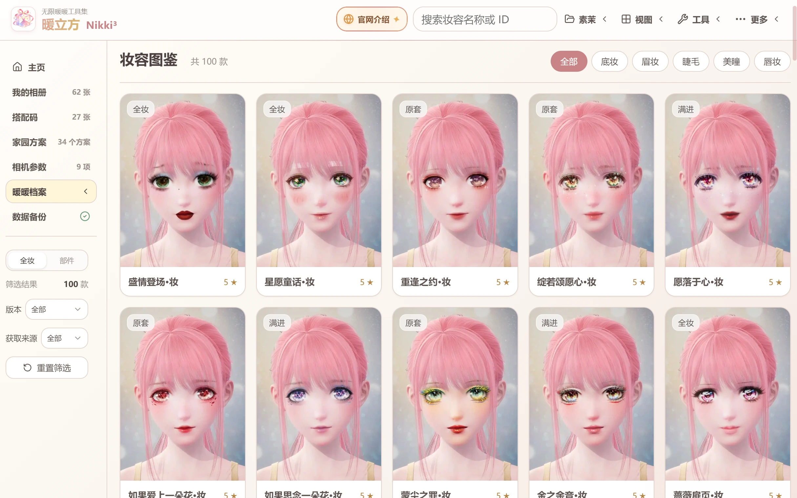
</div>

- 图鉴按全妆、底妆、眉妆、睫毛、美瞳和唇妆分类，支持版本、获取来源、星级筛选及名称／ID 搜索；详情包含组成部件、进化形态、关联全妆和套装。
- 共鸣记录、个人衣橱和搭配解析可跳转到关联妆容；图鉴无需先导入个人档案。
- “视图”中可选择暖暖档案的卡片背景，浅色与深色主题均可用，且会记住选择。

### 专项清理与小工具

#### 专项清理

点击右上角“工具”菜单中的“专项清理”打开清理窗口，使用清理功能需要授权 `X6Game` 文件夹。

支持以下清理项：

- 低画质图片和截图（`...\X6Game\ScreenShot` 与 `NikkiPhotos_LowQuality`）：游戏拍照后产生的画质较低的图片，仅删除图片文件。存在多个账号文件夹时，可选择清理全部账号或指定账号 ID。如果当前管理的相册本身是 `ScreenShot` 或 `NikkiPhotos_LowQuality`，本次清理会跳过该相册目录、只清理另一个目录，并在确认提示中说明，建议管理 `NikkiPhotos_HighQuality` 相册。
- 游戏崩溃时的快照信息（`...\X6Game\Saved\Crashes`）：删除后将无法通过本地日志向官方反馈历史崩溃原因。
- 游戏运行日志（`...\X6Game\Saved\Logs`）：删除后无影响。
- 游戏内置浏览器与登录器缓存（`...\X6Game\Saved\webcache_4430`）：清理过期网页数据，但初次打开活动页面或公告时会加载变慢。

其他工具可从“工具”菜单进入；“更多”提供使用帮助、更新记录与问题反馈。

## 备份与迁移

### 电脑目录自动备份

在左侧「数据备份」中选择专用空文件夹，再按需开启搭配码、家园方案或相机参数。默认全部关闭；只有网页运行、浏览器支持目录访问且授权有效时更新。浏览器仍是主存储，目录副本保留最新状态，删除会同步，不保留历史版本。

可立即备份、检查完整性、暂停写盘后安全复制、按模块恢复或显式重建。自动目录备份不包含游戏相册原图、个人衣橱或共鸣记录，跨设备迁移仍可使用全部数据 ZIP。

### 手动备份与迁移

在“更多”中选择“导出全部数据”，下载的 ZIP 包含搭配方案、家园方案、相机参数、共鸣记录和个人衣橱，以及已保存的方案图片与封面。将 ZIP 传到另一台设备，再通过“导入全部数据”恢复。**游戏相册原图不包含在内，请另行备份。**

ZIP 备份导出使用当前格式：搭配码 v4、家园方案 v2、全部数据 v2。有效的旧版本 ZIP 仍可导入：搭配码 v1–v4、家园方案 v1–v2、全部数据 v1–v2。换网址时，请先在旧站“更多”中导出全部数据，再到 [暖立方新站](https://nikkicube.pages.dev/) 导入原样 ZIP；确认迁移完成前请保留旧站数据。

不同导入入口对已有记录的处理不同：

| 入口 | 对已有记录的影响 |
| --- | --- |
| 暖暖档案 → 添加数据 | 核对预览并选择模块，确认后整份替换勾选模块；预览未包含的旧记录会移除。 |
| 更多 → 导入全部数据 | 按各模块规则合并；相机参数冲突时选择保留方式，不是整份覆盖。 |
| 搭配码模块 → 导入数据 | 添加方案，不覆盖已有方案，重复或无效内容会跳过。 |

共鸣与衣橱共用数据同步窗口，可选择一个或两个模块手动上传、下载。**上传以本地完整记录覆盖对应云端存档，下载以云端完整存档覆盖对应本地记录。**目标端独有记录会移除，未选模块不变；操作前请核对方向与范围，并按需备份。

衣橱中的“未记录”表示手账未返回该散件，不代表游戏中未拥有。仅含共鸣记录的导出文件不能用于导入衣橱。

## 常见问题

### 通用问题

#### 图片无法选择或保存

可重新选择图片重试；替换失败时会保留原图。支持 WebP、PNG、JPEG 等常见格式，HEIC/HEIF 取决于浏览器支持情况，无法使用时可先转为 PNG 或 JPEG。

#### 照片参数无法解析

请使用游戏原图，裁剪、压缩或转存可能丢失解析所需的数据。提示输入 UID 时，请填写拍摄这张照片所用账号的 UID。

#### 图鉴图片或详情加载失败

有重试入口时可点击重试；持续失败时，请检查网络后刷新页面。

### 电脑相册与本地启动

#### 启动器没有反应

- 确认项目已经完整解压，不要在 ZIP 内运行。
- 确认已安装 Node.js 22 或更高版本的 LTS，且 `start` 文件夹没有缺失。
- 检查安全软件是否拦截 EXE 或 BAT 文件。
- 也可直接运行 `start\Start-Remote-D1-Website.bat` 查看错误信息。

#### 网页没有显示照片

- 确认选择的是实际图片目录。
- 确认文件扩展名受支持；文件名以日期格式开头时会优先按文件名整理，其他图片会按文件最后修改时间显示。
- 浏览器权限仍有效时，网站会自动打开上次使用的相册。需要再次授权时，点击「恢复上次授权」。

#### 浏览器拒绝打开文件夹

请选择游戏里的 `X6Game`，避开磁盘根目录和系统目录。如果浏览器仍拒绝访问，可点击「兼容打开（只读）」，直接选择 `NikkiPhotos_HighQuality`。

## 隐私与安全

- 本地照片浏览和照片参数解析在浏览器中完成，不上传照片或照片参数解析结果。
- 搭配码解析会将分享码发送给解析服务，不发送本地照片或手账凭据。
- 云同步支持共鸣记录和个人衣橱，可在同一窗口勾选后一起手动上传或下载。其他模块保存在当前浏览器，更换设备或清理网站数据前请先备份。
- “清除缓存”仅删除解析缓存，不删除已保存的方案、标签和设置。**“清除数据”会永久移除当前浏览器中的记录、图片、收藏、设置及目录授权，并退出云端登录，请先导出备份。**它不会删除云端账号、已上传的云端存档或电脑文件。此操作需要网络连接；若提示清除未完成，可重试或通过浏览器设置清除本站数据。
- 浏览器可能要求重新授权文件夹。
- 相册删除和专项清理会操作电脑中的真实文件；永久删除及专项清理无法恢复。

## 本地安装

环境要求：Windows、[Node.js 22 或更高版本的 LTS](https://nodejs.org/)、电脑上的最新版 Chrome、Edge 或其他兼容的 Chromium 浏览器。

### 安装 Node.js

安装 [Node.js 22 或更高版本的 LTS](https://nodejs.org/)，使用默认安装选项，完成后重新打开启动器。可运行 `node -v` 与 `npm -v` 确认安装成功。

### 本地部署

1. 从 [GitHub Releases](https://github.com/sumopenny/Infinity-Nikki-Toolkit/releases) 或 [Gitee Releases](https://gitee.com/sumopenny/Infinity-Nikki-Toolkit/releases) 下载并解压项目，或从仓库克隆源码。
2. 双击根目录的 `网站启动器.exe`。
3. 首次运行会自动安装依赖；资源更新结束且开发服务器成功开始监听后，才自动打开 `http://localhost:5173`。更新过程中不会提前打开网页；若启动失败或端口被占用，不会打开浏览器，请查看开发服务器窗口中的错误提示。
4. 使用期间不要关闭窗口。

启动器不可用时，可运行 `start\Start-Remote-D1-Website.bat`，或使用下方命令手动启动。启动时需要联网更新资源，更新失败时沿用已有本地资源。

本地运行的点赞、共鸣账号及云同步连接线上服务，相关操作会影响真实线上数据。默认服务地址为 `https://nikkicube.pages.dev`，无需配置或启动本地 D1。可用 `REMOTE_API_ORIGIN` 覆盖服务地址。浏览器本地存档保持原有方式，自动化测试仍使用隔离数据库。

### 开发命令

浏览器存储改动请遵循 [idb 与事务开发约定](docs/browser-storage.md)。

在项目根目录执行：

```bash
npm install                # 安装依赖
npm run dev                # 默认连接 nikkicube.pages.dev 并启动本地网站
npm test                   # 运行自动化测试
npm run build              # 类型检查并构建
npm run build:cloudflare   # 更新资源并构建 Cloudflare 版本
npm run preview            # 预览构建结果
```

---

## 致谢与许可证

仓库参考：[暖暖相册](https://github.com/RanAxro/nikki_albums) 和 [共鸣录](https://github.com/dastrokes/gongeo.us-nikki-tracker)。

本项目许可证请参阅根目录的 [LICENSE](LICENSE) 文件。
搭配总结图表所用的第三方软件声明见 [图表许可证](public/outfit-chart-licenses.txt)。


