# NikkiCube

<div align="center">
  
  <p><strong>Nikki³ · Infinity Nikki Toolkit</strong></p>
  <p>NikkiCube manages albums, outfit codes, home schemes and camera parameters in your browser. Nikki Archive includes resonance records, personal wardrobe and a makeup catalog, alongside backups, optional cloud sync and desktop cleanup.</p>
  <p style="color: orange;">If you run into any issues, please fill out the survey in the site's Feedback section, or report them through GitHub/Gitee Issues or the author's social platforms.</p>
  <p>
    <a href="https://github.com/sumopenny/Infinity-Nikki-Toolkit/releases">GitHub Releases</a> ·
    <a href="https://gitee.com/sumopenny/Infinity-Nikki-Toolkit/releases">Gitee Releases</a> ·
    <a href="https://github.com/sumopenny/Infinity-Nikki-Toolkit">GitHub</a> ·
    <a href="https://gitee.com/sumopenny/Infinity-Nikki-Toolkit">Gitee</a>
  </p>
  <p><a href="README.md"><strong>简体中文</strong></a></p>
</div>

<div align="center">
  <h3><a href="#mobile">📱 Phone guide</a> &nbsp; · &nbsp; <a href="#desktop">🖥️ Desktop guide</a> &nbsp; · &nbsp; <a href="#backup-and-migration">📦 Backup and migration</a> &nbsp; · &nbsp; <a href="#local-installation">⚙️ Local installation</a></h3>
</div>

## Quick Start

### Official website

**Official website (introduction and screenshots): [https://nikki3.pages.dev/](https://nikki3.pages.dev/)**

Use the toolkit here: [https://nikkicube.pages.dev/](https://nikkicube.pages.dev/)

Open it directly without downloading anything. Local features need no sign-in. Outfits, home schemes, camera parameters, and Nikki Archive need no album selection; choose an album only for browsing game photos, and sign in only for resonance and wardrobe cloud sync.

For local use, see [Local installation](#local-installation).

| Feature | Phone / tablet | Desktop |
| --- | --- | --- |
| Outfits, home schemes, camera parameters | Supported | Supported |
| Resonance, personal wardrobe and makeup catalog | Supported | Supported |
| Manual backups, migration, and cloud sync for resonance and wardrobe | Supported | Supported |
| Parse codes or uploaded original photos | Supported | Supported |
| Game album folders and Recently Deleted | Unavailable | Folder authorization required |
| Automatically read in-game outfit codes | Unavailable | X6Game authorization required |
| Clean game files | Unavailable | X6Game authorization required |

[Pages deployment and database configuration](docs/pages-deployment.md)

## Official website showcase

<div align="center">
  
  
  <p><sub>Left · Light mode ｜ Right · Dark mode: introduction, features and toolkit entry</sub></p>
</div>

Visit the [official website](https://nikki3.pages.dev/) for the introduction and full interface showcase. Key interfaces are shown below. For detailed tutorials, open [NikkiCube](https://nikkicube.pages.dev/) and use the in-app help and module import guides.

## Mobile

Phones, tablets, and foldable screens adjust their layout to the available width. The screenshots below illustrate the main entries and actions.

### First use and navigation

- Use the bottom navigation to switch between Outfit codes, Home schemes, Camera parameters, and Nikki Archive. In Nikki Archive, open Resonance records, Personal wardrobe, Makeup catalog, or Evolution animations.
- Use the header magnifier to search the current module. View changes display, theme, and language. Tools contains the parser, Avatar simulator, and Lucky pull times. Open More for full-data backups or select Help for touch gestures.
- “+” adds data, and the page “⋯” menu manages the current module. Use tag or rarity entries to filter. Large previews support swiping, pinch-to-zoom, and panning.
- Use a computer for album folders, automatically reading in-game outfits, and game-file cleanup. On a phone, open More → App maintenance → Install app for home screen instructions. Installation options depend on the browser.

### Outfit codes

Save outfit images and share codes, then copy, edit, or parse them.

<div align="center">
  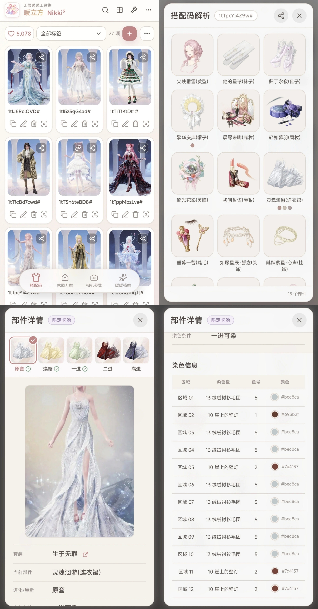
  <p><sub>Outfit list and item details</sub></p>
</div>

- Tap “+” to add **either an image or an outfit code to save a plan**; notes and tags are optional.
- On desktop, open Outfit Summary from the outfit page; on mobile, open it from page actions (…). It shows parsing coverage, collection trends and tag distribution. Select a tag to open its outfits.
- Card actions provide Copy, Edit, Delete, and Parse. Copy and Parse require a code; tap the image for a large preview, or use its bottom-right circle to select multiple plans.
- Use the tag selector to filter or manage tags, and the page “⋯” menu for module ZIP import/export.

### Home schemes and camera parameters

<div align="center">
  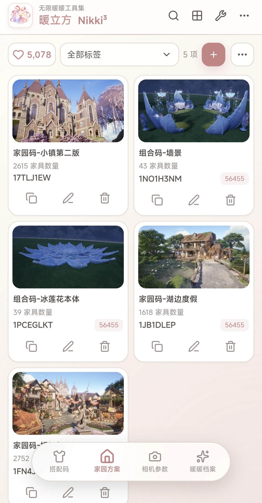
  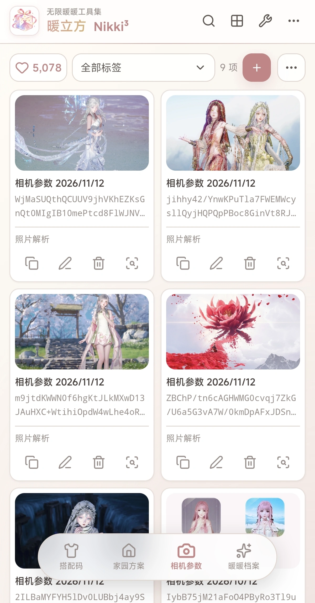
  <p><sub>Left · Home schemes ｜ Right · Camera parameters</sub></p>
</div>

**Home schemes**

- Tap “+”, enter a home code or combo code, then edit the parsed name, cover, notes, and tags before saving.
- Card actions provide Copy, Edit, and Delete. Filter by code type or tag, and tap the image for the large preview.

**Camera parameters**

- Tap “+”, parse a parameter code, then enter a name and save. Covers and tags are optional; parameters can also be saved from photo-parsing results.
- Card actions provide Copy, Edit, Delete, and Details. Copied codes can be imported into the in-game camera.

Both collections use the page “⋯” menu for ZIP import/export. Deleting a tag removes its classification without deleting records.

### Nikki Archive

Open Nikki Archive from the bottom navigation, then switch between Resonance records, Personal wardrobe and Makeup catalog at the top.

<div align="center">
  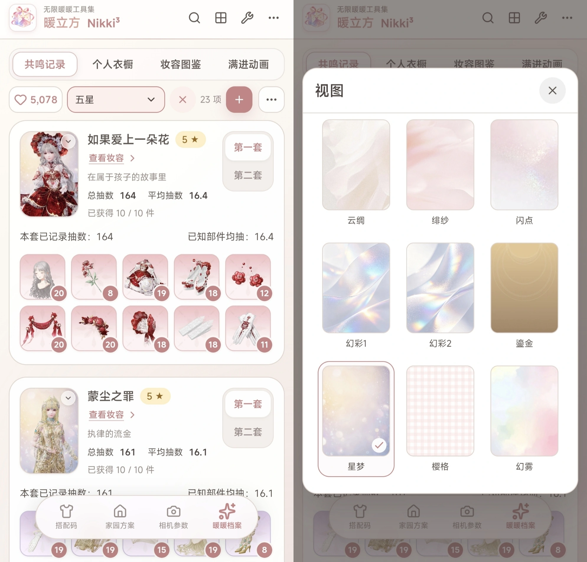
  <p><sub>Resonance: statistics, collection progress, and first/second set switching</sub></p>
</div>

- **Resonance records:** tap “+” to import data, review the preview, then confirm. Use rarity filters to find outfits, and switch between the first and second set on each card.
- For outfits with multiple forms, tap the expand button in the main image’s upper right corner to choose an original, glow-up, or evolution form and view its details. Green checks indicate ownership in your wardrobe data; pull statistics are unchanged.
- The page “⋯” menu provides export, local-record clearing, and account actions. After signing in, manually upload or download cloud records.

<div align="center">
  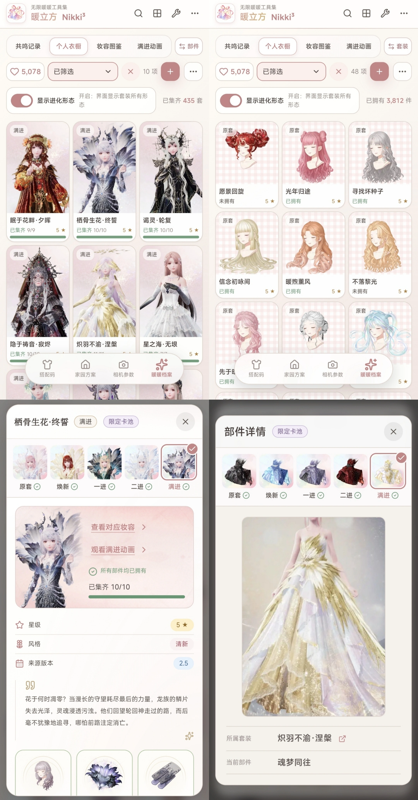
  <p><sub>Personal wardrobe: outfits, pieces, and collection details</sub></p>
</div>

- **Personal wardrobe:** switch between outfits and pieces, search by name or ID, and filter by ownership, rarity, version, and other criteria to inspect collection details.
- Turn on “Show evolution forms” to list forms separately, or turn it off to group each family into one card. Tap the expand icon in a card’s upper right corner and select a form to open its details; forms can also be switched below the detail header.
- Tap “+” to import wardrobe data; use “⋯” to export, clear records or access cloud sync. See [Backup and Migration](#backup-and-migration) for import replacement and cloud-sync rules.

**Makeup catalog (mobile)**

<div align="center">
  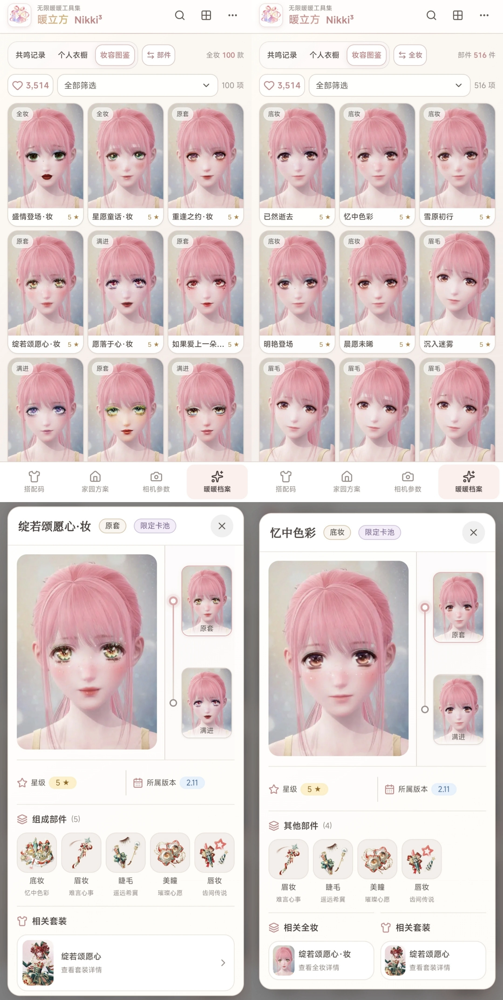
  <p><sub>Full looks, individual parts, evolution forms and details</sub></p>
</div>

- Browse full makeup, foundation, brows, lashes, contacts and lips. Filter by version, source or rarity and search by name or ID.
- Open cards for images, parts, evolution forms, related makeup and outfits; no personal wardrobe import is required.

## Desktop

### First use and navigation

Use desktop Chrome, Edge, or a compatible Chromium browser. Switch modules and filter from the sidebar; search from the header. View controls display, theme, language and background options; Tools opens parsers and utilities; More provides full-data backups and help.

#### Desktop · Install the web app

Open the site's Add to Home Screen entry for desktop browser installation instructions. Supported browsers can install the site in a separate app window; the exact install prompt and menu depend on the browser.

### Albums, photo decoding, and Recently Deleted

Browse game photos by date or action, open large previews, save favorites, and inspect camera settings and outfits recorded in photos.

<div align="center">
  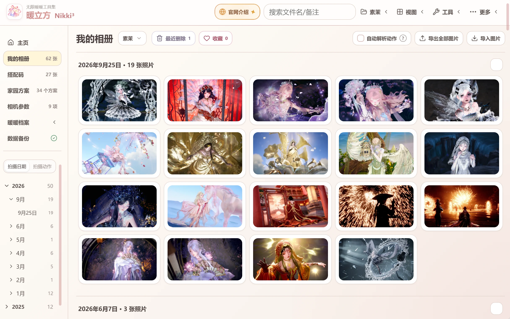
</div>

Click **Authorize X6Game** and select the `X6Game` folder in your game installation:

```text
...\InfinityNikki Launcher\InfinityNikki\X6Game
```

Toolkit looks for high-quality albums under `Saved\GamePlayPhotos` and opens the first account in UID order. If there are several accounts, use **Switch account** next to **All photos**. Choose **Reselect X6Game** to change the game album folder. Outfit codes and cleanup reuse the same access. To browse photos stored elsewhere, select **Open a separate album**.

The top-right album menu shows the current character’s nickname, avatar, level, and the **Character created** and **Last updated** timestamps. The UID identifies the album if the profile cannot be loaded.

#### Compatibility open (read-only)

If normal authorization fails, choose Compatibility open (read-only) and select the folder containing your photos. Browse, filter, preview, parse parameters and view existing favorites and notes without uploading photos or changing the source folder.

Editing favorites or notes, deletion, restoration and importing into the source folder are unavailable; exports download as ZIP files. Select the folder again after refreshing or to read new photos. Switch to normal folder authorization when you need editing.

#### Photo controls

Click a photo for a large preview and use the bottom-right circle to select multiple photos. Favorites, notes, batch export and deletion are supported. Zoom, drag and switch photos in the preview; see in-app help for shortcuts and gestures.

Favorites and notes are stored in `album-metadata.json` inside the album. Another browser can read them by opening the same folder; keep this file with album backups.

> Normal deletion moves originals to Recently Deleted. **Permanent deletion and Special Cleanup remove real computer files and cannot be undone.**

#### Recently Deleted and refresh

- Recently Deleted is sorted by deletion time, with total photo count and total size shown at the top; it supports single or batch restore, permanent deletion, select all, large preview, and clearing everything.
- When restoring, if a file with the same name exists in the original album, suffixes like `_restored_1` and `_restored_2` are used automatically without overwriting existing photos.
- Recently Deleted photos do not expire automatically and remain until restored or manually permanently deleted.

#### Photo share cards

Create portrait or landscape share cards from photo cards or parameter windows, optionally showing camera settings, outfit pieces and camera code. Drag and zoom the preview up to 400%.

### Outfit codes and automatic updates

<div align="center">
  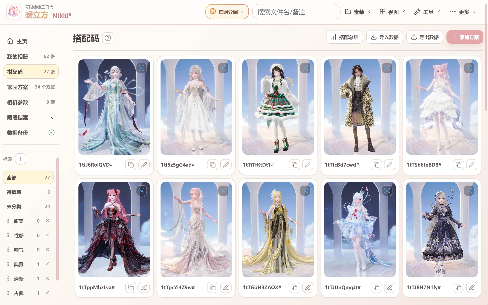
</div>

- Click Add outfit to select, drag or paste an image, or enter an outfit code. **Either an image or a code is sufficient to save a plan**; notes and tags are optional. Click the image for a large preview; use the bottom-right circle or long-press on touch screens to select multiple plans and use the bottom action bar.
- Card actions provide Copy, Edit, Delete, and Parse. Manage categories and tag order in the sidebar. Create up to 40 user tags of up to 5 characters each, with one tag per plan.
- Optionally save a source link in the editor. Pasted share text extracts a single web link; keep only one if multiple links are found. The chain icon on desktop and mobile cards opens the source, and backups preserve the link.
- View or edit notes in the editor and find them through header search. Outfit collections are stored independently in the browser; old album folders are not read or migrated.

#### Automatically update outfit codes

See the [official website](https://nikki3.pages.dev/) for detailed steps and illustrations.

Outfit codes can reuse access to the game album's `X6Game` folder. To grant access just for tools, select **Authorize X6Game** in the Outfit codes page actions. In the game, tap Share, select the screenshot area, generate an outfit code, then return to the website. Import requires a new code and an updated image; duplicates or unchanged or missing images are skipped with a message.

#### Outfit code parsing

Use the card’s Parse action, or enter a code directly in Tools → Parameter / outfit-code parser without creating a plan. Copy and Parse are unavailable for plans without a code.

Click a parsed item to view its details. When multiple forms are available, switch between them using the left sidebar on desktop or the row below the title on mobile. Returning to the worn item preserves its outfit-code dyes; other forms show their own details. Owned forms have a green check beside their names.

#### Outfit summary and share cards

- Tags include all saved outfits, including image-only entries. Clothing and makeup rankings show the number and percentage of parsed outfits containing each item. Filter by type or open an item's details. The summary reads local cached results first and sends outstanding codes for parsing only when you choose Parse or Retry.
- Generate 9:16 share cards for saved outfits with images from a card or parser window; drag and zoom previews up to 400%.

### Home schemes

- Click Add scheme, enter a home or combo code, then edit its parsed name, cover, notes, and tags before saving.
- Filter by code type or tag in the sidebar. Card actions provide Copy, Edit, and Delete; click the image for a large preview.
- Page actions provide module ZIP import/export. Deleting a tag does not delete its schemes.

### Camera parameters

- Open Camera parameters, add and parse a parameter code, then enter a name and save. Covers and tags are optional.
- Parameters can also be saved directly from photo-parsing results. Card actions provide Copy, Edit, Details, and Delete; copied codes can be imported into the in-game camera.
- On desktop, use the view button to the left of Save parameters to switch between stacked and side-by-side layouts when a photo contains outfit data. The initial layout is side-by-side; subsequent visits restore your last choice. The parameter code spans the bottom in split view. Mobile stays stacked without changing the desktop preference.
- When an original game photo contains outfit data, worn parts and dye swatches appear below its camera parameters. Click a part for dye details. Standalone camera codes do not contain outfits. Newer photos may include weather, wind, zoom and pose playback progress where recorded.
- Page actions provide module ZIP import/export. The parser in Tools also accepts parameter codes or original game photos.

### Nikki Archive

Open Resonance records, Personal wardrobe or Makeup catalog from Nikki Archive in the sidebar.

<div align="center">
  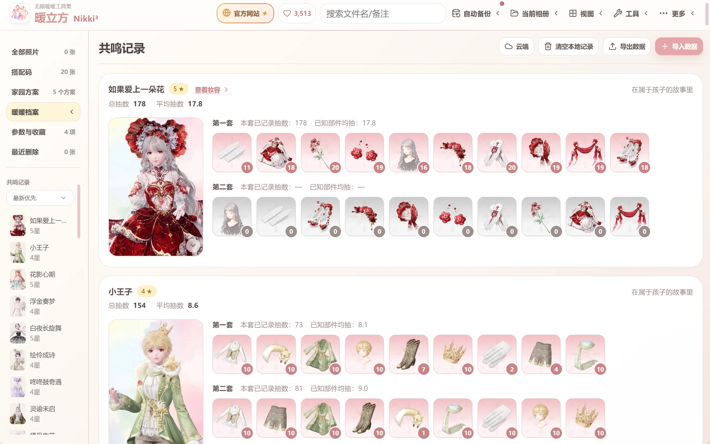
</div>

- **Resonance records:** add notebook credentials or JSON data, review the preview, then confirm. Sort, filter rarity, or find an outfit from the sidebar.
- Expand an outfit using the button in its main image’s lower right corner, then select a form to open its details. Only confirmed owned forms receive green checks; records and statistics are unchanged.
- Desktop shows both sets together, with recorded pulls, known-piece averages, and collection progress for each set. The heading shows combined statistics. Manual entries count toward collection progress; unavailable pull statistics show “—”.
- Page actions provide JSON export, local-record clearing, and account cloud sync.

<div align="center">
  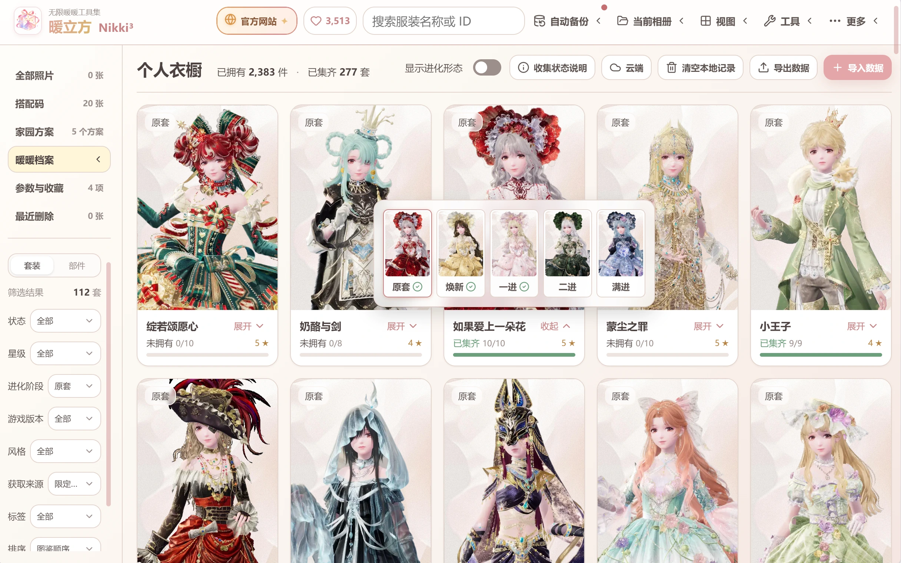
</div>

- **Personal wardrobe:** browse original, recolor, and evolution versions. Switch between outfits and pieces, search by name or ID, and filter by rarity, version, item category, or ownership to view details.
- Use **Show evolution forms** to list all forms or group each family into one card. Your preference is saved. Expand a grouped card to choose a form, or switch forms in outfit and piece details. Desktop outfit details also show source labels.
- Import a Whim-Log notebook from China or any global server, or wardrobe JSON, and export a separate JSON backup. One notebook preview lets you choose both resonance and wardrobe data. Clearing wardrobe records does not affect resonance. Wardrobe and resonance share an account and one sync dialog, allowing selected modules to upload, download or delete together. The makeup catalog can be browsed without imported data; its static reference images are not part of wardrobe sync saves.
- Check the replacement rules in [Backup and Migration](#backup-and-migration) before importing.

### Evolution animations

Open **Evolution animations** in Nikki Archive to browse outfit animations grouped by version, newest first. Click the cover or a card below the player to load Bilibili. Matching outfit details include a shortcut to the animation, and each video links to its original Bilibili part.

### Makeup catalog and backgrounds

<div align="center">
  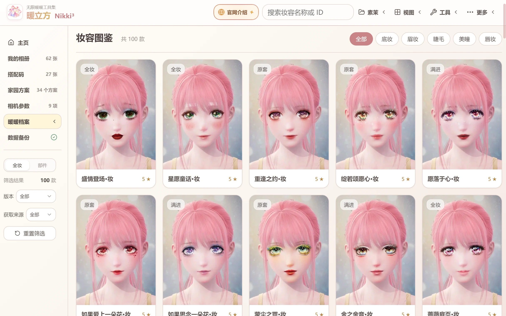
</div>

- Browse full makeup, foundation, brows, lashes, contacts and lips. Filter by version, source or rarity and search by name or ID. Details include parts, evolution forms, related makeup and outfits.
- Resonance, wardrobe and outfit parsing link to makeup details without requiring an archive import.
- Choose an archive card background from View in light or dark theme; the preference is remembered.

### Cleanup and utilities

#### Special Cleanup

Open Special Cleanup from the upper-right Tools menu to open the cleanup window. Using the cleanup features requires authorizing the `X6Game` folder.

The following cleanup items are available:

- Low-quality photos and screenshots (`...\X6Game\ScreenShot` and `NikkiPhotos_LowQuality`): lower-quality images produced by in-game photography; only image files are deleted. When multiple account folders exist, you can choose to clean all accounts or a specific account ID. If the album you are currently managing is itself `ScreenShot` or `NikkiPhotos_LowQuality`, the cleanup skips that album folder and only cleans the other one, with a note in the confirmation prompt; managing the `NikkiPhotos_HighQuality` album is recommended.
- Crash snapshots (`...\X6Game\Saved\Crashes`): after deletion, historical crash causes can no longer be reported to the official team via local logs.
- Runtime logs (`...\X6Game\Saved\Logs`): deleting them has no side effects.
- Built-in browser and login cache (`...\X6Game\Saved\webcache_4430`): clears expired web data, but event pages and announcements load more slowly the first time they are opened afterwards.

Open other utilities from Tools. More provides usage help, update notes, and feedback.

## Backup and Migration

### Automatic folder backup

On desktop, open **Data backup** in the sidebar, choose a dedicated empty folder, and enable outfit codes, home schemes, or camera parameters individually. All switches are off by default. Updates require the page to remain running in a supported browser with valid folder permission. Browser storage remains primary; folder backups mirror the latest state, including deletions, without history.

The page supports manual runs, integrity checks, pausing writes for safe copying, module restoration, and explicit rebuilding. Original game photos, wardrobe data, and resonance records are outside automatic folder backup; use the existing ZIP exports for migration.

### Manual backup and migration

From More, choose Export all data to download a ZIP containing outfit plans, home schemes, camera parameters, resonance records, and the wardrobe, including saved scheme images and covers. Transfer the ZIP to another device, then choose Import all data there. **Game album originals are not included; back them up separately.**

ZIP exports use the current formats: outfit codes v4, home schemes v2, and full-data backups v2. Valid older ZIP backups can still be imported: outfit codes v1–v4, home schemes v1–v2, and full-data backups v1–v2. When moving to a new URL, export all data under More on the old site, then import the unchanged ZIP at [the new NikkiCube site](https://nikkicube.pages.dev/). Keep the old site data until migration is confirmed.

Different import entries handle existing records differently:

| Entry | Effect on existing records |
| --- | --- |
| Nikki Archive → Add data | Review the preview, choose the modules, and confirm to replace all records in those modules. Old records absent from the preview are removed. |
| More → Import all data | Merges collections according to each module's rules. Camera-parameter conflicts ask which version to retain; this is not a full replacement. |
| Outfit module → Import data | Adds plans without overwriting existing ones; duplicate or invalid entries are skipped. |

Resonance and wardrobe share a data-sync dialog. Select one or both modules to upload or download manually. **Upload replaces corresponding cloud saves with complete local records; download replaces corresponding local records with complete cloud saves.** Destination-only records are removed; unselected modules remain unchanged. Check the direction and scope, and back up first when needed.

Unrecorded wardrobe pieces were absent from the notebook response; this does not mean they are unowned in the game. A resonance-only export cannot be imported as wardrobe data.

## FAQ

### General questions

#### An image cannot be selected or saved

Try selecting the image again. A failed replacement retains the previous image. Common formats such as WebP, PNG, and JPEG are supported; HEIC/HEIF depends on browser support, so convert it to PNG or JPEG if needed.

#### Photo parameter parsing fails

Use the original game photo. Cropping, compression, or saving it through another app may remove the data needed for parsing. If prompted for a UID, enter the UID of the account that took the photo.

#### Catalog images or details fail to load

Use the retry action where available. If loading still fails, check the network and refresh the page.

### Desktop albums and local startup

#### The launcher does nothing

- Make sure the project has been fully extracted, and do not run it inside the ZIP.
- Make sure Node.js LTS version 22 or newer is installed and the `start` folder is not missing.
- Check whether security software blocked the EXE or BAT file.
- You can also run `start\Start-Remote-D1-Website.bat` directly to view error details.

#### No photos are displayed

- Make sure you selected the actual image folder.
- Make sure the file extension is supported. Photos whose filenames start with a date use that date; other photos use the file's last modified time.
- Toolkit automatically reopens the last album while browser permission is still granted. If it expires, select **Restore previous access**.

#### The browser refuses to open a folder

Select the game's `X6Game` folder and avoid drive roots and system folders. If the browser still refuses it, use **Open in compatibility mode (read-only)** and select `NikkiPhotos_HighQuality` directly.

## Privacy and Safety

- Local photo viewing and photo-parameter parsing happen in your browser; photos and photo-parameter results are not uploaded.
- Outfit-code parsing sends the share code to parsing services, without sending local photos or notebook credentials.
- Cloud sync supports resonance records and the personal wardrobe; select both in one dialog to upload or download them together. Other collections remain in the current browser; back them up before changing devices or clearing site data.
- Clear cache removes parsing caches without deleting saved schemes, tags, or settings. **Clear data permanently removes this browser's saved records, images, favorites, settings, and folder authorizations, and signs you out of the cloud. Export a backup first.** It does not delete your cloud account, uploaded cloud saves, or files on your computer. A network connection is required. If clearing does not complete, retry or clear this site's data through browser settings.
- Browser security policies may require you to authorize folders again.
- Album deletion and Special Cleanup operate on real files on your computer. Permanent deletion and cleanup cannot be undone.

## Local installation

Requirements: Windows, [Node.js LTS version 22 or newer](https://nodejs.org/), and the latest desktop version of Chrome, Edge, or another compatible Chromium browser.

### Install Node.js

Install [Node.js LTS version 22 or newer](https://nodejs.org/) with the default options, then reopen the launcher. Run `node -v` and `npm -v` to verify installation.

### Local deployment

1. Download and extract the project from [GitHub Releases](https://github.com/sumopenny/Infinity-Nikki-Toolkit/releases) or [Gitee Releases](https://gitee.com/sumopenny/Infinity-Nikki-Toolkit/releases), or clone the source repository.
2. Double-click `网站启动器.exe` in the project root.
3. On first run, dependencies are installed automatically. The browser opens `http://localhost:5173` only after resource updates finish and the dev server successfully starts listening. It does not open during updates or after a startup failure or port conflict; check the dev server window for errors.
4. Keep the window open while using it.

If the launcher is unavailable, run `start\Start-Remote-D1-Website.bat`, or use the commands below. Resource updates require network access; failed updates keep the existing local resources.

The local site connects to the online service for Likes, shared cloud accounts, and resonance/wardrobe cloud sync. These actions affect real online data. The default service is `https://nikkicube.pages.dev`; no local D1 setup or startup is required. Override it with `REMOTE_API_ORIGIN` if needed. Browser-local storage is unchanged, and automated tests still use isolated databases.

### Development Commands

For browser storage changes, see the [idb and transaction conventions](docs/browser-storage.md) (Chinese).

Run these commands in the project root:

```bash
npm install                # Install dependencies
npm run dev                # Start locally using nikkicube.pages.dev by default
npm test                   # Run automated tests
npm run build              # Type-check and build
npm run build:cloudflare   # Update resources and build for Cloudflare
npm run preview            # Preview the build
```

---

## Acknowledgements and License

Reference repositories: [Nikki Albums](https://github.com/RanAxro/nikki_albums) and [Gongeo.us Nikki Tracker](https://github.com/dastrokes/gongeo.us-nikki-tracker).

Please refer to the root [LICENSE](LICENSE) file for this project's license.
See the [chart licenses](public/outfit-chart-licenses.txt) for the third-party notices for Outfit Summary.


